# KracKill$ Vision v1.0

A browser-based 3D audio visualizer in one HTML file. It shows the spectrum of an audio input as a volume of points, stacks three layers with filters, splits stems, places video clips on a timeline and exports video.

- **Hosted:** https://whatiphmedia.github.io/KracKill-Vision-v1.0/
- **Offline:** download `index.html` and open it in a browser.

Audio, video and images are processed on your computer and are never uploaded.

---

## Contents

1. [Quick start](#quick-start)
2. [Layout](#layout)
3. [Design rules](#design-rules)
4. [How audio becomes the picture](#how-audio-becomes-the-picture)
5. [Modules](#modules)
   - [3D Volumetric Waveform Visualizer](#3d-volumetric-waveform-visualizer)
   - [Audio Input Calibration](#audio-input-calibration)
   - [Variable Matrix [DNA]](#variable-matrix-dna)
   - [Krack'd Vision](#krackd-vision)
   - [Krack'd FX](#krackd-fx)
   - [Color Palette Select](#color-palette-select)
   - [Krack'd Theme](#krackd-theme)
   - [Timeline & Waveform](#timeline--waveform)
   - [Export Module](#export-module)
   - [Header](#header)
6. [Interface behaviour](#interface-behaviour)
7. [Mobile](#mobile)
8. [Security and privacy](#security-and-privacy)
9. [Hosting and model files](#hosting-and-model-files)
10. [Roadmap](#roadmap)
11. [Credits and licences](#credits-and-licences)

---

## Quick start

1. Open the app.
2. In **Timeline & Waveform**, pick an input: **Open audio file…**, **Mic**, **Tab audio** or **Demo**.
3. Press **Play**.
4. Shape the look in the side modules. Each change applies to the selected layer.
5. Set the format in **Export Module** and press **Export render**.

---

## Layout

| # | Module | Use |
|---|---|---|
| 1 | Variable Matrix [DNA] | Every numeric setting of the selected layer. Each one can follow the music. |
| 2 | Krack'd Vision | Kaleidoscope filter, applied before Krack'd FX. |
| 3 | Krack'd FX | Post filters, in a stacking order you choose, with masks. |
| 4 | 3D Volumetric Waveform Visualizer | The picture: layers, source, colour mode, spectrum display, camera, forms. |
| 5 | Color Palette Select | Colours used when a layer is set to palette colour. |
| 6 | Krack'd Theme | Interface colours and the reactive interface elements. |
| 7 | Audio Input Calibration | How the input is measured and scaled before it drives the picture. |
| 8 | Timeline & Waveform | Transport, RGB waveform, stems, video lanes, keyframes, mini game. |
| 9 | Export Module | Video export settings. |
| 10 | Log bar | Status and progress readout. |
| 11 | Header buttons | Preset manager, OSC, Debug log, Fullscreen. |

The visualizer stays in the centre and the modules sit around it.

---

## Design rules

These rules were set for the project and explain most of the choices below.

- **Free and open.** Anyone who needs visuals can use it. There are no accounts and no paid services.
- **Self-contained.** Everything runs from the one file. The only outside downloads are the stem-splitting runtime and models, each downloaded once and checked against a published checksum before use (see [Hosting and model files](#hosting-and-model-files)).
- **No access to other user data.** Settings stay in this browser. Presets move between sessions as files you export and import yourself.
- **Stems drive visuals only.** You always hear the original mix. Stem volume, mute and solo change only what drives the picture.
- **Works across browsers and on phones** where the browser allows it.

---

## How audio becomes the picture

This is the path from the input to the points on screen, and the reason for each step.

### 1. Analysis

- **FFT:** 2048-point, with a Blackman or Hann window (Blackman by default).
- **Level:** the magnitude is |X|/N in dB, on the same scale as the Web Audio analyser, with 0.5 smoothing between frames.

### 2. Calibration

Each layer has its own calibration, applied in this order:

1. **Input gain** (dB).
2. **Tilt** (dB per octave around 1 kHz). This is a fixed EQ slope, so the dynamics are left untouched.
3. **dB floor and dB ceiling**, which set the range that maps to zero and full height.
   - With the floor at its lowest stop (−∞), nothing is cut. Linear amplitude then starts at true silence. The dB displays need a finite bottom, so they show the 120 dB below the ceiling.
4. **Sensitivity** and **Compress**.
5. **Attack** and **Peak decay**, which control how fast values rise and fall.
6. **Low cut** and **High cut**, which limit the frequency range used.

### 3. Spectrum display

Set per layer, from the visualizer bar or from Audio Input Calibration.

| Setting | Frequency axis | Amplitude |
|---|---|---|
| **Log F · dB** (default) | 1/12-octave (semitone) bands | dB |
| **Log F · linear amp** | 1/12-octave bands | Linear |
| **Linear F · dB** | Evenly spaced bins | dB |

On the log axis, each band shows its **loudest FFT bin**. Bands narrower than one FFT bin interpolate at their centre.

### 4. Mapping into the volume

- **X:** amplitude (vertical).
- **Y:** frequency (horizontal). It runs low to high and continues across all rows.
- **Z:** time (depth). Older values recede.
- Rows are linked end to start, so the spectrum reads as one continuous line through the whole volume.

### 5. RGB frequency colour

Serato-style colouring, used for the points and for the timeline waveform:

| Colour | Band |
|---|---|
| Red | Bass, below 200 Hz |
| Green | Mids, 200 Hz – 4 kHz |
| Blue | Treble, above 4 kHz |

The timeline waveform is rendered offline through three filters at these crossovers, then measured per column.

---

## Modules

Each module with layer buttons **a b c** shows that layer's settings. The visualizer's own **a b c** buttons select the layer, and every module follows that selection.

### 3D Volumetric Waveform Visualizer

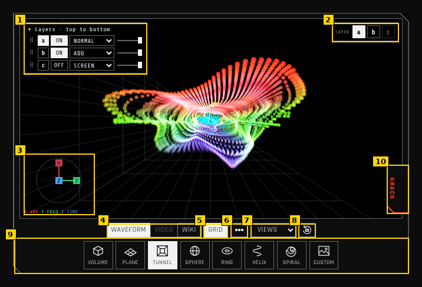

| # | Control | Use |
|---|---|---|
| 1 | Layers panel | Three layers, listed top to bottom. Drag ⠿ (or focus it and press ↑ / ↓) to reorder. Each layer has show/hide, blend mode and opacity. |
| 2 | Axis gizmo | X amplitude (vertical), Y frequency (horizontal), Z time (depth). |
| 3 | Waveform / Video | What the selected layer shows. **Video** is greyed out until a clip is routed to that layer. |
| 4 | Color mode | RGB frequency colour, Palette colour, or Image colour (Custom). |
| 5 | Spectrum display | Log F · dB, Log F · linear amp, Linear F · dB. |
| 6 | Grid | Shows or hides the workspace grid. |
| 7 | Lines | Draws lines between the points. |
| 8 | Views | Preset camera views: centre, front, back, top, bottom, both sides. |
| 9 | Reset camera | Returns the camera to its default position. |
| 10 | Forms | Volume, Plane, Wall, Tunnel, Sphere, Ring, Helix, Spiral, Custom (shaped by an image). |

- **Blend modes:** Normal, Add, Screen, Lighten, Darken, Multiply, Overlay, Soft light, Difference, Exclusion, Subtract, Color dodge.
- **Camera:** drag to orbit, Shift-drag to pan, scroll to change distance. Camera settings in Variable Matrix › Camera can follow the music.
- **Per-layer state:** each layer has its own geometry, spectrum history, calibration, Vision, FX, mask and video settings.

### Audio Input Calibration

| # | Control | Use |
|---|---|---|
| 1 | Auto-calibrate from file | Sets the input gain so the loaded file peaks at −1 dBFS, then sets the dB ceiling from its loudest band (never above 0 dB). The floor is left alone. |
| 2 | Spectrum display | Same setting as in the visualizer bar, for the selected layer. |
| 3 | FFT window | Blackman or Hann. |
| 4 | Spectrum graph | Each dot is a 1/12-octave band showing its loudest FFT bin. The coloured areas are the reactive bands. |
| 5 | Processing | Input gain, tilt, dB floor and ceiling, peak decay, sensitivity, attack, compress, low and high cut (see [Calibration](#2-calibration)). |
| 6 | Bands | Up to six reactive bands, plus **Level** and **Beat**. Each band has on/off, colour, low and high cutoff, sensitivity, reaction, and linking to its neighbour. |

- **Editing bands:** click a band (or its colour box) to edit it, and drag band edges on the graph. Linked edges move together.
- **Bands as sources:** the bands are the reactive sources offered in Variable Matrix.

### Variable Matrix [DNA]

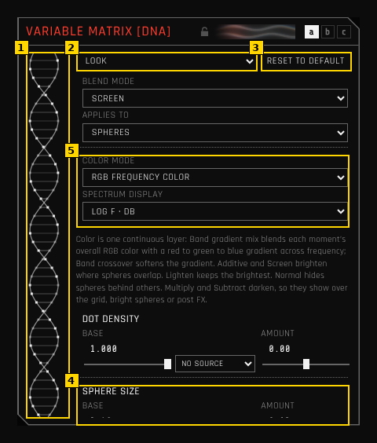

| # | Control | Use |
|---|---|---|
| 1 | DNA view | The helix spins and focuses on a strand as you edit settings. |
| 2 | Category | Motion, Noise, Volume, Transform, Look, Camera, Vision, FX, Grid, Custom, Video. |
| 3 | Reset to default | Resets the settings in the current category. |
| 4 | Setting | **Base** value, a **source** and an **amount**. |

**Reactivity.** A setting with a source moves by *source × amount × its range* around its base value.

- **Sources:** Level, Beat, Red (bass), Green (mids), Blue (treble), the reactive bands, and the four stems once they are split.

**Categories:**

- **Motion:** wave height, time span, time fall-off.
- **Noise:** noise warp, scale, speed.
- **Volume:** width (Y frequency), height (X amplitude), depth (Z time), spread, time length.
- **Transform:** move, turn and spin about each axis.
- **Look:** sphere blend mode, dot density, sphere size, size by volume, opacity, glow, brightness, saturation, band gradient mix, band crossover, line opacity.
- **Camera:** zoom, field of view, auto orbit, elevation offset, roll, shake.
- **Vision:** the Krack'd Vision sliders.
- **FX:** the parameters of the filters that are turned on.
- **Grid:** dot counts on Y (frequency) and Z (time), helix and spiral turns, and the wrap seam for tunnel, sphere and ring.
  - Mirror puts low frequencies at the seam and high frequencies opposite it.
  - Crossfade gives one full 20 Hz – 20 kHz sweep.
- **Custom:** the image for the Custom form, per layer.
  - Float value uses brightness as elevation; RGB value uses R, G, B as Y, X, Z positions.
  - Backdrop shows the image behind the points.
  - Build spectrum drives the layer from the image instead of the audio.
- **Video:** see [Video lanes](#video-lanes).

Any value can be typed: click the number.

### Krack'd Vision

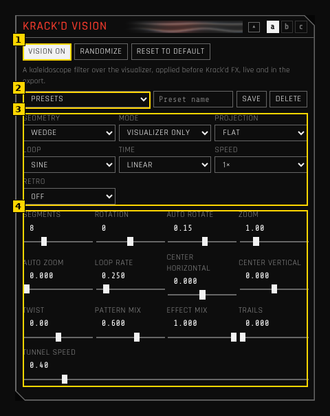

A kaleidoscope filter over the visualizer. It is applied **before** Krack'd FX, both live and in the export.

| # | Control | Use |
|---|---|---|
| 1 | On/off, Randomize, Reset | Turn Vision on or off, randomize it, or restore every setting. |
| 2 | Presets | Save, name, recall and delete Vision looks. |
| 3 | Styles | Geometry, mode, projection, loop, time, speed, retro. |
| 4 | Sliders | Segments, rotation, auto rotate, zoom, auto zoom, loop rate, centre, twist, pattern mix, effect mix, trails, tunnel speed. |

### Krack'd FX

These are post filters, run on top of Krack'd Vision, both live and in the export. The catalogue is a grouped, sorted list of 71 filters in ten groups: Adjust, Distortion, Blur, Pixelate, Lighting, Color, Stylize, Screen, Generate and Utils.

| # | Control | Use |
|---|---|---|
| 1 | All off, Reset to default | Turn every filter off, or restore every filter's settings. |
| 2 | Mask | Draw closed shapes on the visualizer, and the layer's FX apply only inside them. |
| 3 | Order | Drag to set the stacking. The top filter is applied last, over the rest, like the layer list. |
| 4 | Groups | Click a group to open it. |

**Mask:**
- **Invert** flips the masked area.
- **Tracked regions** follow the Tracking effect's boxes.
- **Falloff and size** sliders sit in the visualizer's top-right corner. The falloff is smooth so that soft effects have no hard edge.
- **Video:** a video can also act as the mask (see [Video lanes](#video-lanes)).

### Color Palette Select

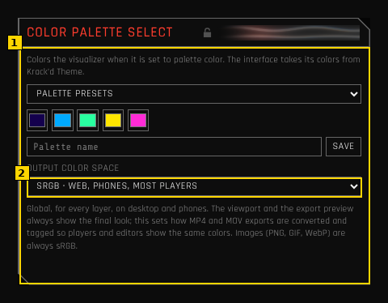

These are the colours used by layers set to **Palette colour**. Pick a preset, edit the swatches, and save named palettes. The interface itself takes its colours from Krack'd Theme. The video lanes take their identifying colours from palette colours 2–4.

### Krack'd Theme

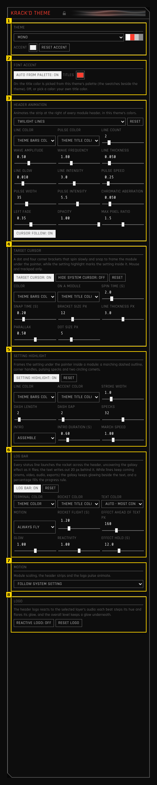

| # | Section | Use |
|---|---|---|
| 1 | Theme | Interface theme (MONO, SIGNAL, ACID, CYAN, MAGENTA, AMBER, PAPER) and an accent colour. |
| 2 | Font accent | Picks the title colour from the theme's own palette, or lets you choose your own. |
| 3 | Header animation | The animated strip at the right of every module header, in the theme's colours. |
| 4 | Target cursor | A dot and four corner brackets that frame the **module** under the pointer. Mouse and trackpad only. |
| 5 | Setting highlight | Frames the **setting** under the pointer inside a module. The game strip is excluded. |
| 6 | Log bar | Colours, motion and reactivity of the header log bar. |
| 7 | Motion | Module scaling, header strips and logo pulse. By default this follows the system's reduced-motion setting. |
| 8 | Logo | The header logo reacts to the selected layer's audio: hue steps on each beat, and the glow follows the level. |

The target cursor and the setting highlight give two levels of feedback: which module you are in, and which setting you are on. Both use the theme's colours.

### Timeline & Waveform

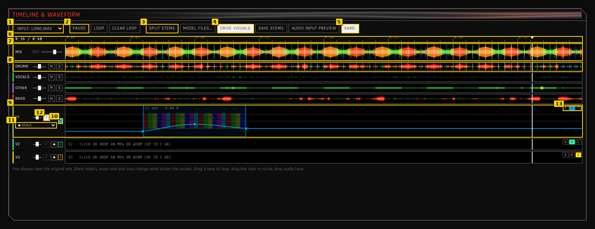

| # | Control | Use |
|---|---|---|
| 1 | Input | Demo, Mic, Tab audio, or an audio file. |
| 2 | Transport | Play/Pause, Loop, Clear loop. |
| 3 | Split stems / Model files… | Spleeter 4-stem split (see [Stems](#stems)). Model files… loads the four model files from disk for fully offline use. |
| 4 | Drive visuals / Save stems / Audio input preview | **Drive visuals:** the stem mix drives the picture instead of the full mix. **Save stems:** writes the stems to files. **Audio input preview:** lets you hear the stem settings (exports always use the full mix). |
| 5 | Game | Shows or hides the mini game strip. |
| 6 | Ruler | Drag to scrub. |
| 7 | Mix | RGB waveform of the track, with the output volume. |
| 8 | Stem lanes | Drums, vocals, other, bass, each with volume, **M** (mute) and **S** (solo). They appear only after a split. |
| 9 | Video lane | V1–V3 (shown here with keyframes open). |
| 10 | **+** | Opens the keyframe curves for this lane. |
| 11 | Keyframed setting | Chooses which setting the curve edits. |
| 12 | ♪ | Adds the clip's audio to the output. |
| 13 | A B C | Routes the clip to a layer, for preview and export. |

**Basics:**
- Drag across any lane to set a loop.
- Drop an audio file anywhere in the module to load it.
- When the Export module is folded, the timeline uses the full width.

#### Stems

- **Engine:** Spleeter 4-stem (Deezer, Apache-2.0), split into drums, vocals, other and bass.
- **Where it runs:** on this computer, in background workers, several blocks at once across your CPU cores. A full song takes seconds.
- **Download:** the models are about 79 MB, downloaded once and cached in the browser. Each file is checked against its SHA-256 before use.
- **What stems change:** only what drives the visuals. Stems can also be sources in Variable Matrix.
- **Why Spleeter only:**
  - HT-Demucs was tried. On the CPU it took about 8 minutes per song, and its GPU path did not work reliably in browsers.
  - A fast estimate mode was also removed.
  - Spleeter's accuracy was judged sufficient.

#### Video lanes

| Item | Behaviour |
|---|---|
| Files | MP4 or WebM, up to 1 GB, so the clip's audio can still be decoded in memory. |
| Loading | Click an empty lane or drop a file on it. Files open locally (blob URLs) and are never uploaded. |
| Trim and place | Drag the bars at the ends of a clip to trim it. Drag the middle to move it on the timeline. |
| Routing | A / B / C at the lane's top right. Loading a clip switches its layer to Video and turns the layer on. |
| As a layer | A routed clip is a full layer. It blends with the layer blend modes and takes Krack'd Vision and Krack'd FX. |
| Sync | Clips play muted, locked to the timeline clock, with small drift corrected by playback rate. Larger jumps seek. |
| Clip audio | The ♪ toggle and level slider add the clip's own audio to the output, to the input that drives the visuals, and to exports. |
| No audio track | If a video is loaded with no audio track, a silent track as long as the clips keeps the timeline running. |
| Phones | The preview picture is drawn at a maximum of 480 px. |

**Variable Matrix › Video** (per layer):

- **File info:** name, resolution, frame rate, length, trim, place on the timeline, size, audio.
- **Layer shows:** Waveform or Video, and **Fit** (Contain, Cover, Stretch).
- **Move, Scale, Rotate, Opacity, Brightness.** Each can follow the music or be keyframed. Move and Scale are in picture heights.
- **FX mask:** the clip masks the layer's Krack'd FX.
  - **Luminance** mode applies the FX where the video is bright. **RGB** mode applies it per colour channel.
  - **Invert** flips the mask.
  - The mask works whether the layer shows the waveform or the video.

#### Keyframes

- **Open:** press **+** at the start of a video lane to open a curve editor on that lane.
- **What can be keyframed:** the dropdown under the lane's audio slider lists the Krack'd FX settings that are on, the Krack'd Vision settings (when Vision is on), and the Video settings of the layer the lane is routed to.
- **Editing:**
  - Click to add a point.
  - Drag a point to move it.
  - Double-click or right-click a point to delete it.
- **Curves:** smooth, with no overshoot between points.
- **How a curve applies:** it sets the setting's base value over time. Reactivity still adds on top.
- **Colours:** each lane has a palette colour. Keyframed settings show a stripe in that colour in Variable Matrix and Krack'd FX, including on a closed FX group's header.
- **Saving:** keyframes and lane routing are saved with each preset.

#### Mini game

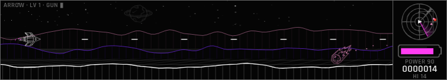

- **When it appears:** the strip opens at the bottom of the module while stems split or the track plays. The **Game** button hides it independently of playback.
- **Start:** before a game starts, only the terrain, the background and **GAME START** show.
- **Controls:**
  - W A S D move, K fires, Esc ends the game.
  - On touch screens, drag to steer and the ship fires while your finger is down.
- **Scene:**
  - A side-scroller with an isometric tilt.
  - A 3D grid sits behind three terrain ridges driven by the bass, mids and highs of the playing audio.
  - Stars and planets drift behind at different speeds.
- **Ships:** one of six is picked at random, each with its own speed, fire rate and maximum power.
- **Enemies:** 12 types plus a boss, with randomised speed, fire rate, size and strength, and some tougher elites. They fire back.
- **Hazards:** comets and galaxies can't be shot down. Galaxies pull the ship in.
- **Power-ups:**
  - heart: power
  - lightning: rapid fire
  - ring: shield
  - coin: points
  - **?**: a random bonus
- **Power and radar:**
  - The power bar drains by the strength of whatever hits you.
  - The radar shows enemies, hazards and power-ups before they enter the strip.
- **Scoring:**
  - Points per kill, with a combo multiplier up to ×8, plus points for survival time and coins.
  - Reaching the end of the track shows YOU WIN with a bonus.
  - The high score is stored in this browser.

### Export Module

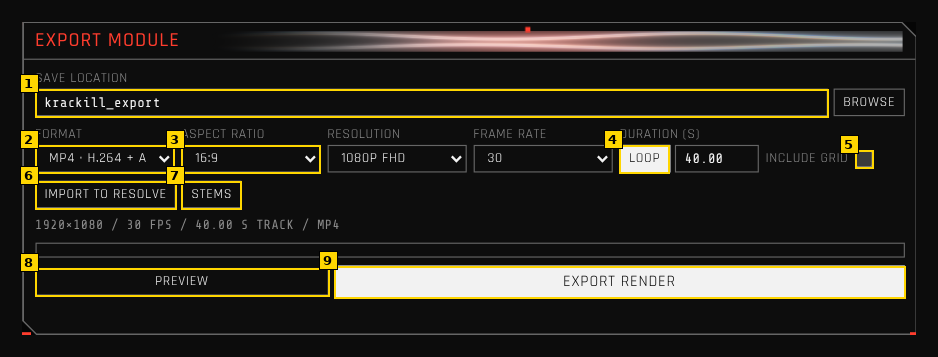

| # | Control | Use |
|---|---|---|
| 1 | Save location | File name. **Browse** picks where to save, in browsers that support it. |
| 2 | Format | MP4 (H.264 + AAC), MOV (H.264 + PCM, for editors), animated WebP, GIF. |
| 3 | Aspect ratio / Resolution / Frame rate | 16:9, 9:16, 1:1, 4:3, 4:5, 21:9 · 480p to 2160p · 24, 25, 30, 50, 60 fps. |
| 4 | Duration | **Loop** matches the loop, or the whole track when no loop is set. Otherwise type a length in seconds. |
| 5 | Include grid | Includes the workspace grid in the render. |
| 6 | Import to Resolve | Also writes a DaVinci Resolve timeline (.fcpxml) next to an MP4/MOV, with matching frame rate, resolution and length, the audio, beat markers, and split stems on their own tracks. In Resolve, use File › Import › Timeline. |
| 7 | Preview | Opens a preview window that sizes itself to the window. |
| 8 | Export render | Renders the export. |

- **What is exported:** only the visualizer, with no interface.
- **How it renders:** in real time against the playing timeline. Video lanes, keyframes and clip audio are included.
- **MOV:** uses PCM audio for compatibility with editing software.
- **No AAC:** if the browser has no AAC encoder, the audio is saved as a WAV next to the video.
- **Folding:** the ▸ button folds the module to a slim tab on the right, so the timeline gets the full width.

### Header

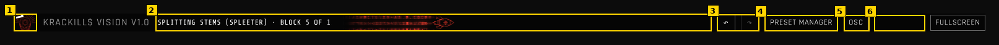

| # | Item | Use |
|---|---|---|
| 1 | Logo | Reacts to the selected layer's audio. |
| 2 | Log bar | Status readout. See below. |
| 3 | Preset manager | Save, name and recall presets, share them as codes, export or import the whole set. |
| 4 | OSC | Map settings to an outside OSC controller. |
| 5 | Debug log | Download a log to share when something goes wrong. |

**Log bar**

- **New status line:** the game's rocket flies across the header and uncovers the galaxy effect as it goes. The text writes out 20 px behind the uncovered part.
- **Same line updating** (only numbers change, such as timers and percentages): the galaxy glows to the right of the text instead of relaunching the rocket.
- **Progress:** a percentage in the line fills a progress rule under it.
- **Text colour:** the theme colour with the most contrast against black, with a dark halo so it stays readable over the stars.
- **Motion:** by default the rocket flies even when the system asks for reduced motion. Theme › Log bar › Motion can make it follow the Motion setting instead.

**Preset manager**

- **Contents:** a preset holds all three layers, plus video-lane keyframes and routing.
- **Naming:** presets are numbered by default and can be named.
- **Codes:** a single preset can be shared as a text code.
- **Cache file:** the whole set can be exported to a file and imported in a later session. Presets otherwise live only in the current tab.
- **Deleting:** a preset or the cache is deleted only after an "Are you sure" confirmation.
- **Loading codes:** codes and files are checked on load. Unknown or out-of-range values are dropped or clamped.

**OSC**

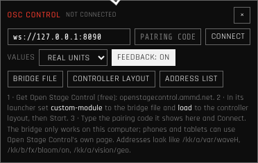

- **Bridge:** a custom module for **Open Stage Control** (free, open source). Nothing else needs installing.
- **Coverage:** every variable, every Krack'd FX switch and parameter, the Krack'd Vision settings, and the colour settings, for each layer.
- **Address format:**
  - `/kk/a/var/waveH`
  - `/kk/b/fx/bloom/intensity`
  - `/kk/a/vision/geo`
  - `/kk/palette/1`
- **Values:** sent in real units or as 0–1.
- **Feedback:** when on, changes made in the app move the controller's faders.
- **Address list:** downloads every address with its type and range.
- **Bridge security:**
  - It listens only on your computer (127.0.0.1).
  - It accepts only this app, opened from a file, from your computer, or from the hosted site.
  - A pairing code is required within 30 seconds.
  - Only published addresses with numbers or colours are relayed, and the message rate is limited.
  - Nothing received can run code or touch files.
- **Setup:** in Open Stage Control, set **custom-module** to the bridge file and **load** to the layout, then press **Start**. Type the pairing code into the OSC panel and press **Connect**.
- **Phones and tablets:** they use Open Stage Control's own web page.

**Debug log**

- **Storage:** kept in memory only.
- **Contents:** the download includes the environment, capabilities, current settings and every logged event.
- **Privacy:** nothing leaves the computer unless you download the log and share it.

---

## Interface behaviour

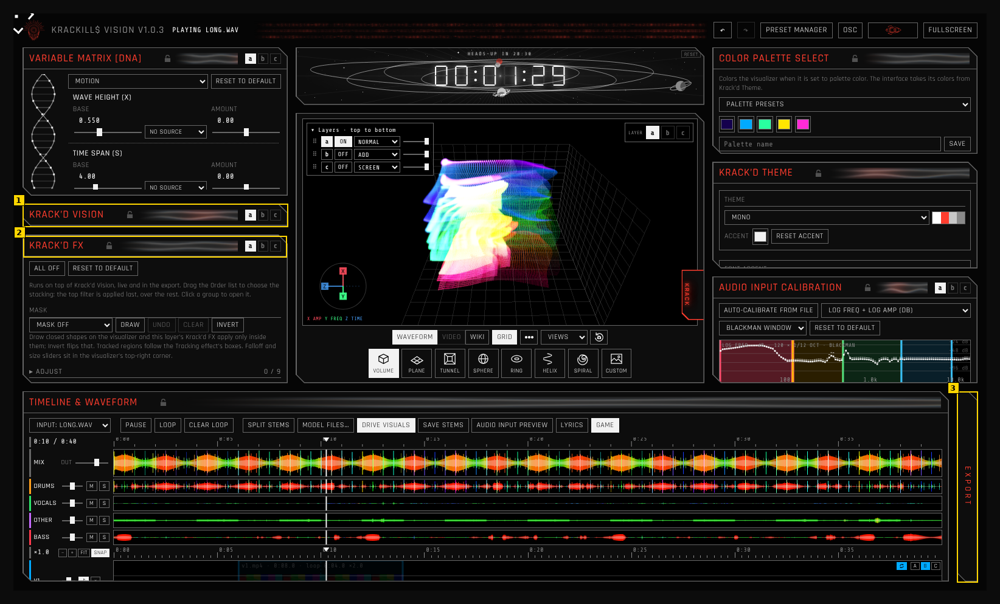

| Behaviour | Detail |
|---|---|
| Hover scaling | The module under the pointer grows and the others in its column shrink, with no gap left. It starts immediately on hover and takes 0.2 s. It is off on touch screens and narrow windows. |
| Minimize (1, 2) | Side modules roll up to their header with ▴. The other modules in the column take the space. |
| Fold Export (3) | ▸ folds Export to the right, so the timeline gets the full width. |
| Remembering | Minimize and fold states are remembered in this browser. |
| Typed values | Click any number to type a value. On hover the number turns the theme's contrast colour. While typing, a thin box frames it, and the box fades out when the pointer leaves. |
| Motion | Animations follow the system's reduced-motion setting unless Theme › Motion overrides it. |

The 3D visualizer, Export and Timeline modules can't be minimized by height. Export folds to the right instead.

---

## Mobile

| Item | Phone behaviour |
|---|---|
| Layout | Modules are stacked in one column. **Timeline & Waveform** sits directly under the visualizer, so the input and transport are reachable without scrolling; the other modules follow. **Pinned** keeps the visualizer at the top while the modules scroll. |
| Header strips | Each module's animated strip stays locked to its own module. |
| Stem tools | Split stems, Model files, Drive visuals, Save stems and Audio input preview are hidden on phones. |
| Video | The preview picture is drawn at a maximum of 480 px. |
| Hover effects | Hover scaling, the target cursor and the setting highlight are off on touch screens. |
| Game | Touch controls: drag to steer, auto-fire while touching. |

---

## Security and privacy

| Measure | Detail |
|---|---|
| Local processing | Audio, video and images are read from your computer and never uploaded. |
| Content Security Policy | Connections are allowed only to your own computer (OSC), this site, the pinned runtime path on jsDelivr, the repository's raw files, and the pinned Spleeter path on Hugging Face. |
| Runtime integrity | ONNX Runtime Web 1.31.1 files are checked with SHA-256 (SRI) before use. |
| Model integrity | Each Spleeter model must match its published SHA-256 and size, whatever its source. A changed file is refused. |
| Embedded libraries | three.js r128 (unchanged) and the fonts are embedded in the file. |
| Settings | Stored only in this browser (localStorage, IndexedDB for cached models). |
| Presets | Codes and files are checked on load, so unknown keys and out-of-range values are dropped or clamped. |
| OSC | See [OSC](#header). |

---

## Hosting and model files

| Item | Detail |
|---|---|
| `index.html` | The app. |
| `vocals / drums / bass / other.fp16.onnx` | Spleeter 4-stem models (about 19.7 MB each). |

The app looks for the models in this order, and checks every copy against its SHA-256:

1. **The site the page is served from.** On GitHub Pages, `index.html` sits next to the models.
2. **This repository's raw files**, pinned to a commit, for copies opened from a file.
3. **Hugging Face**, as a last fallback.

The ONNX Runtime files (about 12 MB) are fetched from jsDelivr, pinned to version 1.31.1. Models and runtime are cached in the browser after the first use.

To host your own copy, enable GitHub Pages: **Settings › Pages › Deploy from a branch › main › / (root)**.

---

## Roadmap

- Updates as feature requests and bug reports come in.
- More theme and reactive element options.
- More waveform modes, with settings for each.

---

## Credits and licences

| Component | Licence |
|---|---|
| KracKill$ Vision | See `LICENSE` (Apache-2.0) |
| Spleeter models (Deezer) | Apache-2.0 |
| ONNX Runtime Web | MIT |
| three.js r128 | MIT |
| Rajdhani (Indian Type Foundry), Share Tech Mono (Carrois Type Design), via @fontsource | SIL Open Font License 1.1 |

Game sprites were supplied by the project owner and traced to vector outlines.

The interface effects were written for this app after these references:

- React Bits Target Cursor, Tech Text and Galaxy
- React Bits Pro Twilight Lines
