# KracKill$ Vision v1.0

A browser-based 3D audio visualizer in one HTML file. It shows the spectrum of an audio input as a volume of points, stacks three layers with filters, splits stems, transcribes and times lyrics, cuts lyric-driven encyclopedia pages, places video clips and camera moves on a timeline and exports video.

- **Hosted:** https://whatiphmedia.github.io/KracKill-Vision-v1.0/
- **Offline:** download `index.html` and open it in a browser.

Audio, video and images are processed on your computer and are never uploaded.

---

## Contents

1. [Quick start](#quick-start)
   - [Examples](#examples)
2. [Layout](#layout)
3. [Design rules](#design-rules)
   - [Why the recent additions](#why-the-recent-additions)
4. [How audio becomes the picture](#how-audio-becomes-the-picture)
5. [Modules](#modules)
   - [Session](#session)
   - [3D Volumetric Waveform Visualizer](#3d-volumetric-waveform-visualizer)
   - [Audio Input Calibration](#audio-input-calibration)
   - [Variable Matrix [DNA]](#variable-matrix-dna)
   - [Krack'd Vision](#krackd-vision)
   - [Krack'd FX](#krackd-fx)
   - [Color Palette Select](#color-palette-select)
   - [Krack'd Theme](#krackd-theme)
   - [Timeline & Waveform](#timeline--waveform)
   - [Lyrics](#lyrics)
   - [Wiki layer](#wiki-layer)
   - [Export Module](#export-module)
   - [Header](#header)
6. [Interface behaviour](#interface-behaviour)
7. [Mobile](#mobile)
8. [Security and privacy](#security-and-privacy)
9. [Hosting and model files](#hosting-and-model-files)
10. [Roadmap](#roadmap)
11. [Credits and licences](#credits-and-licences)
12. [Get involved](#get-involved)

---

## Quick start

1. Open the app. The startup mix plays once, from your first click or key press.
2. To use your own audio, pick an input in **Timeline & Waveform**: **Open audio file…**, **Mic**, **Tab audio** or **Demo**.
3. Press **Play**.
4. Shape the look in the side modules. Each change applies to the selected layer.
5. Set the format in **Export Module** and press **Export render**.

For a random starting point, press **Release the krack** in the visualizer (see [Release the krack](#release-the-krack)).

For lyric-driven pages: split stems, open **Lyrics** and press **Transcribe** (or paste the words), then set a layer's source to **Wiki** (see [Lyrics](#lyrics) and [Wiki layer](#wiki-layer)).

### Examples

Viewport renders from **Release the krack**, captured while the startup mix plays: 50 picked from 180 presses, each an unedited result. All 50 are in [docs/examples.md](docs/examples.md).

<table>
<tr><td width="33%">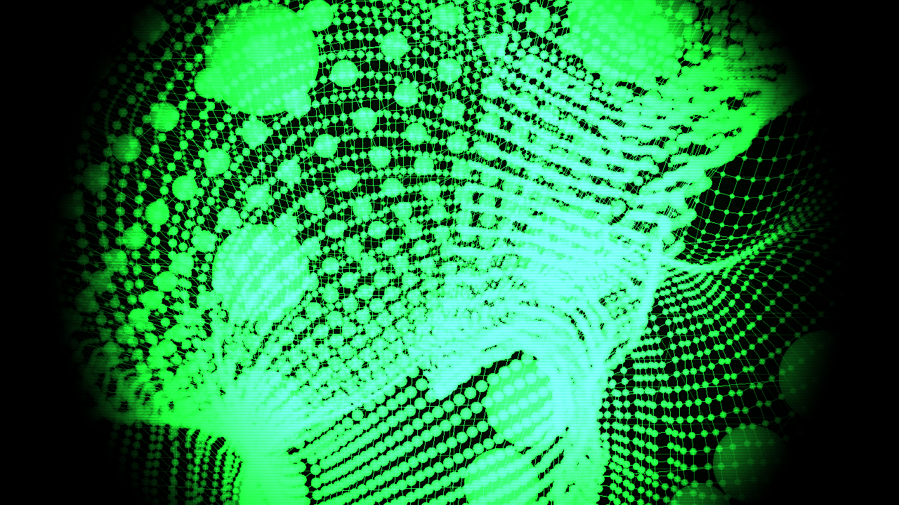</td><td width="33%"></td><td width="33%"></td></tr>
<tr><td width="33%"></td><td width="33%"></td><td width="33%">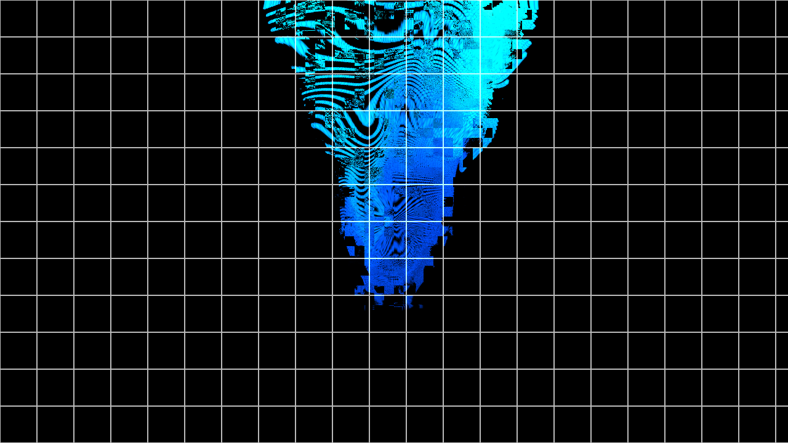</td></tr>
</table>

---

## Layout

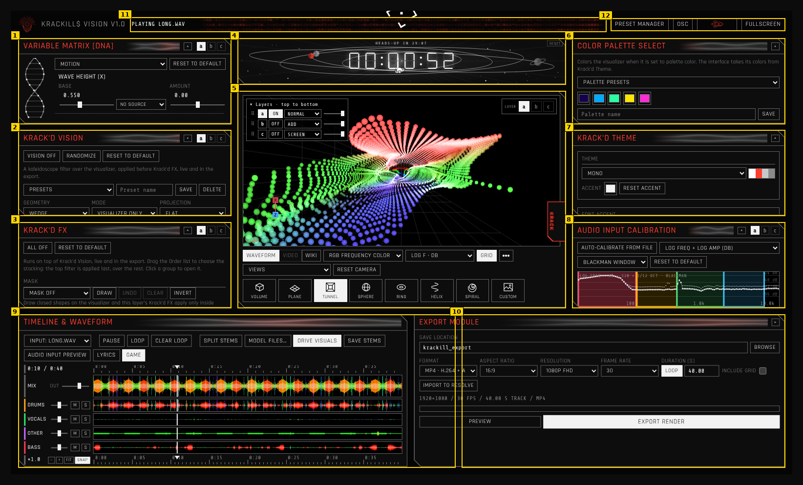

| # | Module | Use |
|---|---|---|
| 1 | Variable Matrix [DNA] | Every numeric setting of the selected layer. Each one can follow the music. |
| 2 | Krack'd Vision | Kaleidoscope filter, applied before Krack'd FX. |
| 3 | Krack'd FX | Post filters, in a stacking order you choose, with masks. |
| 4 | Session | Session timer with a heads-up every 30 minutes. |
| 5 | 3D Volumetric Waveform Visualizer | The picture: layers, source (waveform, video or Wiki), colour mode, spectrum display, camera, forms, Release the krack. |
| 6 | Color Palette Select | Colours used when a layer is set to palette colour. |
| 7 | Krack'd Theme | Interface colours and the reactive interface elements. |
| 8 | Audio Input Calibration | How the input is measured and scaled before it drives the picture. |
| 9 | Timeline & Waveform | Transport, RGB waveform, stems, lyrics, zoom, video lanes, keyframes, camera path, mini game. |
| 10 | Export Module | Video export settings. |
| 11 | Log bar | Status and progress readout. Click it for the full log. |
| 12 | Header buttons | Preset manager, OSC, Re-launch, Fullscreen. |

The visualizer stays in the centre and the modules sit around it.

- **First visit:** Krack'd Vision, Krack'd FX, Color Palette Select, Krack'd Theme and Export open minimized. After that the browser remembers your own layout.
- **Start-up:** the logo plays over the visualizer, then fades out to the waveform. The splash is part of the page itself, so the very first frame already shows it and nothing behind it flashes up first. It fits inside the visualizer window at any size, phones included. Click or tap to skip it.
- **No visualizer header:** the visualizer module has no header, so the window gets that height. Its layer chooser (and on phones the Pin button) sits inside the window, top right.
- **First look:** the Tunnel form in the Front view. Glow, brightness and noise warp start at 0 and follow the music: brightness the Level, glow the Beat, noise warp Band 1. Their amounts are picked at random on each load, between 50% and 100%. Until the first click or key press the picture stays flat, and a slowly bouncing **Tap here to start** button sits in the middle of the visualizer. It stops bouncing when the system asks for reduced motion.
- **Visualizer controls at start-up:** until the first tap, only the grid and **Tap here to start** show in the visualizer. Then the layers panel and the axis gizmo fade in. About 4 seconds later, the log bar's rocket flies across the visualizer and uncovers the Release the krack module behind it. On this first flight the rocket is as tall as the button.
- **Startup mix:** an embedded track plays once, from the first click or key press (browsers allow sound only after one). When it ends, a prompt offers **Open audio file…** or **Play the mix again**. Your own tracks end without a prompt.

---

## Design rules

These rules were set for the project and explain most of the choices below.

- **Free and open.** Anyone who needs visuals can use it. There are no accounts and no paid services.
- **Self-contained.** Everything runs from the one file, including the startup mix. The only outside files are the model runtime and the stem and transcription models. They are fetched when you run the tool that needs them, checked against a published checksum, and kept in memory for that session only (see [Hosting and model files](#hosting-and-model-files)). Wikipedia lookups are off unless you turn them on.
- **No access to other user data.** Settings stay in this browser. Presets move between sessions as files you export and import yourself.
- **Stems drive visuals only.** You always hear the original mix. Stem volume, mute and solo change only what drives the picture.
- **Works across browsers and on phones** where the browser allows it.
- **Light.** Effects are drawn with plain 2D canvas or CSS, measured for frame cost, and paused when they are off screen. Heavy work (stems, transcription, lookups) runs in background workers, so the picture keeps its frame rate.
- **Room for the picture.** The visualizer gets every pixel it can: it has no header, and nothing else (such as the mini game) takes height from it.
- **Rhythm.** How things open and close matters as much as how they look. Glows and fades ease in and out with a smooth falloff, never a hard step, and linked effects end together.

### Why the recent additions

- **Lyrics and the Wiki layer.** Words are part of a track's picture. The Wiki layer turns each sung word into a hard cut to an encyclopedia page with that word marked, so the visual follows the vocal, not only the spectrum. The page is its own full-frame layer, so it blends, filters and exports like any other.
- **Transcription on this computer.** Typing and timing lyrics by hand is the slow part. Whisper writes the words with their times from the vocal stem, without sending audio anywhere. When you already have the right words, it can keep them and take only the timing, because a transcription will mishear some words.
- **Wikipedia only when asked.** Real article text looks better than stand-in text, but it means going online. It is off by default; when on, only the word is sent, nothing else, and every export that shows it gets a credits file, since the text is CC BY-SA.
- **Models for the session only.** A stem split or a transcription is usually run once per session, so the models are fetched when needed and kept in memory instead of being stored in the browser. Nothing stays on the computer after the tab closes.
- **No header on the visualizer, and a game that never takes its room.** Screen space goes to the picture first. The layer chooser moved inside the window, and on desktop the mini game strip opens inside the Timeline module instead of shrinking the visualizer.
- **Blend modes for lines.** The Look tab's blend mode can apply to the spheres, the lines or both, and Release the krack picks it too, never Multiply or Subtract, which tend to turn a random look black.
- **Re-launch on the refresh.** A reload can't be animated across, so the blast-off now plays on the fresh page from its very first frame, in a background worker, and the app comes up underneath it. The motion lands when the reset really happens.
- **Phones get the same impact.** Release the krack and Re-launch rumble every module on phones too, and the ripple runs up from the bottom of the screen. When the mini game opens below the screen, the bottom edge glows until you scroll to it, then the module's rim pulses twice and both fade out together.
- **Session clock.** Long sessions lose track of time. A clock that is part of the picture keeps time in view without breaking focus, and the heads-up every 30 minutes is a nudge to rest your eyes and ears, not an alarm.
- **Planets, particles and glow.** Time is shown as motion, not only as numbers: each orbit is a clock hand, and a body passing the digits pulls their light. The passing of time becomes something to watch, for under a millisecond a frame.
- **Stars, comets and the alien flyby.** Small, rare events reward attention without asking for it. The flyby uses the mini game's own enemies, a first step toward a more playful app.
- **Mini game module on phones.** On a phone the game gets its own space at the bottom of the screen, where thumbs already are, and one faint ripple marks its arrival instead of a sound or a banner.
- **One volume, fewer forms.** Volume is now a true volume, with a value at every point inside it rather than one surface repeated, which opens the way to volumetric variables. Wall was the Plane stood up, so it was folded into Plane.
- **Terminal header and warp.** The log bar is where the app reports what it is doing, so it now reads like a terminal, in one colour. The warp ties the clock to each press: a new look is a jump, and time visibly jumps with it. The heads-up uses the same jump to say, briefly, take a break.
- **Release the krack.** It is the most-pressed control, so it is built to feel physical: it gives under the press and reacts like a struck screen. The warning sign is honest: a press replaces the look on the layer, and the last 20 looks are kept in Recall. Bend and end wiggle joined the randomizer so presses reach the newer shape settings.
- **Grid style button, fold tab and log readout.** Fewer controls, placed where they act. The log readout shows every change the app makes as it happens, so nothing it does is hidden from you.
- **Cleanup.** A pass over the whole file removed a duplicated image, unused code and dead styles, and moved per-frame lookups to a few times a second.

---

## How audio becomes the picture

This is the path from the input to the points on screen, and the reason for each step.

### 1. Analysis

- **FFT:** 2048-point, with a Blackman or Hann window (Blackman by default).
- **Level:** the magnitude is |X|/N in dB, on the same scale as the Web Audio analyser, with 0.5 smoothing between frames.

### 2. Calibration

Each layer has its own calibration, applied in this order:

1. **Input gain** (dB).
2. **Tilt** (dB per octave around 1 kHz). This is a fixed EQ slope, so the dynamics are left untouched.
3. **dB floor and dB ceiling**, which set the range that maps to zero and full height.
   - With the floor at its lowest stop (−∞), nothing is cut. Linear amplitude then starts at true silence. The dB displays need a finite bottom, so they show the 120 dB below the ceiling.
4. **Sensitivity** and **Compress**.
5. **Attack** and **Peak decay**, which control how fast values rise and fall.
6. **Low cut** and **High cut**, which limit the frequency range used.

### 3. Spectrum display

Set per layer, from the visualizer bar or from Audio Input Calibration.

| Setting | Frequency axis | Amplitude |
|---|---|---|
| **Log F · dB** (default) | 1/12-octave (semitone) bands | dB |
| **Log F · linear amp** | 1/12-octave bands | Linear |
| **Linear F · dB** | Evenly spaced bins | dB |

On the log axis, each band shows its **loudest FFT bin**. Bands narrower than one FFT bin interpolate at their centre.

### 4. Mapping into the volume

- **X:** amplitude (vertical).
- **Y:** frequency (horizontal). It runs low to high and continues across all rows.
- **Z:** time (depth). Older values recede.
- **Volume form:** a true volume. Its layers are loudness levels stacked from quiet (bottom) to loud (top), each covering the full spectrum and time. A point lights only where the sound at its frequency and moment reaches its level, softly at the edge, so the volume fills up to the waveform's surface. Colour, glow and size are graded through the levels, so every point in the volume carries its own value: in RGB frequency colour the levels run through the band colours, in Palette colour through the palette. Wave height sets how far the sound fills up the levels. At the default settings the volume is a cube; Time length does not stretch it. Points the sound does not reach stay faintly lit, so the whole volume is always visible. It is drawn at half the Dots Y and Dots Z resolution, so its default 10 levels cost about as much as two and a half other forms.
- **Centred forms:** every form is centred on the pivot, so turning, spinning and orbiting happen around its middle. On the forms with a time length (Volume, Plane, Tunnel, Helix), the time axis stretches both ways from the centre. The camera backs off by the distance their front end comes forward, so the framing of the front stays the same.

### 5. RGB frequency colour

Serato-style colouring, used for the points and for the timeline waveform:

| Colour | Band |
|---|---|
| Red | Bass, below 200 Hz |
| Green | Mids, 200 Hz – 4 kHz |
| Blue | Treble, above 4 kHz |

The timeline waveform is rendered offline through three filters at these crossovers, then measured per column.

---

## Modules

Each module with layer buttons **a b c** shows that layer's settings. The visualizer's own **a b c** buttons select the layer, and every module follows that selection.

### Session

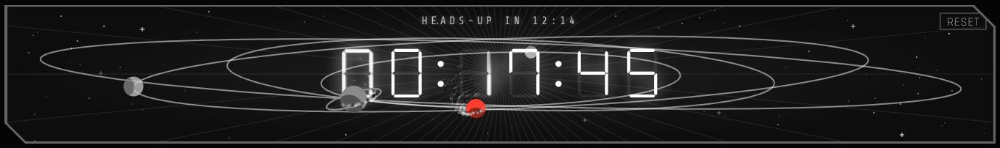

A session timer in the style of an old LCD alarm clock, with four bodies in orbit over a fine radial line burst and a soft glow. It has no header, to save space.

- **Start:** the counter starts with the session (the first tap, click or key press). Until then it blinks 00:00:00, like a clock after a power cut.
- **Orbits:** four bodies go round every **15 seconds, 30 seconds, 1 minute and 5 minutes** of session time, so their positions read like clock hands. The orbits are nearly level, and each is moved up or down by a random offset on every load. They are solid lines that run behind the digits. The innermost orbit is just wide enough to clear the digits on either side; the outermost fills the module, and the other two sit evenly between. Each body takes one of the four colours of the interface theme and is lit by the digits: its shadow falls on the side away from them, and fades out while it is over them. It passes in front of the digits on the near side of its orbit and behind them on the far side, easing between full and 60% opacity as it goes round. Every body stays fully inside the module.
- **Pull:** a body passing in front of the digits draws a stream of particles off the nearest digit: from the side facing the body, along the digit's full height. The stream falls onto a tilted plane around the body, goes once all the way round it, then tapers off and sinks in. Each body swirls in its own direction. On the far side of the plane the particles pass behind the body, smaller and dimmer; on the near side they pass in front of it, larger and brighter. Each particle leaves a short trail, and about one in eight is dark dust. Particles are dimmer than the bodies and digits, and fade over their life: they keep most of their brightness early and fall away toward the end. While a digit is being pulled it flickers by 27% and glows near the body, fading smoothly with distance, as if its light is pulled too. The glow eases in as the pull starts and out after it ends. The digits themselves do not move, and bodies behind the digits draw nothing.
- **Stars:** stars twinkle slowly and drift very slowly from left to right, wrapping around. They show around the edges and thin out smoothly toward the middle, so the digits stay clear.
- **Warp:** every press of Release the krack sends the clock to warp speed for 1.2 seconds: the stars stream past toward you while the planets, orbits and time zoom past, then everything wraps around and grows back from the centre to its place.
- **Comets:** now and then (the first time 8 to 23 seconds into the session, then every 25 to 70 seconds) a comet appears at a random point along the top edge of the module and streaks right to left, heading down at a diagonal, with a fading tail.
- **Flyby:** now and then (the first time 20 to 45 seconds into the session, then every 40 seconds to 2 minutes) one of the mini game's enemies, picked at random, crosses the module on a random curved path in 4 seconds.
- **Heads-up:** every 30 minutes the scene warps into three short break phrases (such as STAND UP, BREATHE or REST EYES, picked at random), shown one after another in the clock's own 7-segment font for about 4 seconds each, then warps back to the time. The log bar shows how long the session has run. Click the module to end it early. At the top of the module, a countdown shows the time to the next heads-up.
- **Reset** (top right corner): restarts the timer.
- **Digits:** DSEG7 Classic Light, a free 7-segment font (SIL Open Font License), spaced out, in the theme colour with the most contrast against the module, with unlit segments showing faintly behind.
- **Place:** above the visualizer. On phones it is the first module.
- **Light:** it draws only while the module is on screen. With reduced motion the bodies still move with the time, once every quarter second, and the digits don't blink.

### 3D Volumetric Waveform Visualizer

The module has no header, so the window takes that height.

| # | Control | Use |
|---|---|---|
| 1 | Layers panel | Three layers, listed top to bottom. Drag ⠿ (or focus it and press ↑ / ↓) to reorder. Each layer has show/hide, blend mode and opacity. Click its title to fold it. |
| 2 | Layer chooser | **a b c** selects the layer every module edits. On phones the **Pin** button sits next to it. On narrow windows the open layer panel reaches under it, so it fades out while the panel is open; the panel's own a/b/c rows choose the layer then. |
| 3 | Axis gizmo | X amplitude (vertical), Y frequency (horizontal), Z time (depth). |
| 4 | Waveform / Video / Wiki | What the selected layer shows. **Video** is greyed out until a clip is routed to that layer. **Wiki** shows lyric-driven encyclopedia pages (see [Wiki layer](#wiki-layer)). |
| 5 | Color mode | RGB frequency colour, Palette colour, or Image colour (Custom). |
| 6 | Spectrum display | Log F · dB, Log F · linear amp, Linear F · dB. |
| 7 | Grid | Shows or hides the workspace grid. |
| 8 | Grid style | Each press moves the selected layer to the next grid style: all dots (three dots), all lines (three stacked lines), then dots and lines (a small dot grid). The icon shows the current style. |
| 9 | Views | Preset camera views: centre, front, back, top, bottom, both sides. |
| 10 | Reset camera | Returns the camera to the Front view. |
| 11 | Forms | Volume, Plane, Tunnel, Sphere, Ring, Helix, Spiral, Custom (shaped by an image). Switching between forms morphs the points smoothly; switching to or from Volume, which has its own point layout, changes at once. |
| 12 | Release the krack | One-press random look for the selected layer. See below. |

- **Blend modes:** Normal, Add, Screen, Lighten, Darken, Multiply, Overlay, Soft light, Difference, Exclusion, Subtract, Color dodge.
- **Camera:** drag to orbit, Shift-drag to pan, scroll to change distance. Camera settings in Variable Matrix › Camera can follow the music.
- **Per-layer state:** each layer has its own geometry, spectrum history, calibration, Vision, FX, mask and video settings.
- **Frame rate:** the viewport runs at up to 60 fps, including on 120 / 144 Hz screens. Exports are not capped.

#### Release the krack

A one-press random look for the **selected layer**. Other layers are not changed. Each press sends the log bar's rocket across the visualizer: about 60% of the visualizer's size, along one of six paths picked at random (never the same twice in a row): an arc, a dip, an S-curve, a low swoop, and two corner-to-corner diagonals. The rocket launches the moment the button is pressed and crosses in a random 0.6–0.9 seconds, with a black and white pixel blast-off on the left edge at its entry height: a flash, a shockwave ring, debris, a fire plume (the classic PSX Doom fire technique) and smoke, all blasting to the right. The smoke clears quickly.

At the same moment a shockwave ripples from the left edge across the whole visualizer module, interface included, taking 1.6 times as long as the rocket's flight. A faster flight hits harder: the ripple and the shake are stronger. Near the start of the wave the module turns into a black and white ordered dither. The dither fades faster than the ripple and is gone before the wave reaches the middle, so the low-res blast seems to dissolve into the full-res picture. The rocket flies above the wave, but passes under the Add a track prompt when that is open. Every module also shakes on its own, as if pushed by the blast: a big first jolt with a long tail, about 0.34 seconds, scaled with the flight. The shaking starts at the visualizer and travels outward, nearest module first, weaker further away. On phones every module shakes the same way, and instead of the shockwave one ripple with dither runs up the app from the bottom of the screen.

**The button:** it has no header. The label is stacked, RELEASE THE over **KRACK**, set as a justified block: KRACK is sized to the top line and stretched 10% wider, the top line is spaced out to the same width, and the whole label is stretched another 15%, with clear margins on every side. Underneath, a line grid warps around a soft lens, and a radial mask drops the grid to about 40% under the text. The label has a strong chromatic aberration (a wide magenta and cyan split) to draw the eye. With a mouse, the lens follows the pointer; while you hover the button, the colour split points away from the pointer, and otherwise it sways on its own.

**The press:** the session clock warps (see [Session](#session)), and for 1.2 seconds a warning sign replaces the label, bouncing in scale while its colour split twitches. In the same span the grid caves in around the press point and springs back, the button dips, VHS tracking bands, noise and tearing lines roll through it like a CRT that has just been hit, and the whole tile rumbles and settles. Every press replays it. It starts folded on a first visit, so it does not crowd the first look: only a tab at the right edge shows, with KRACK reading top to bottom and a slow pulsing glow. Press the tab to unfold it; the ▸ tab on its left folds it away again, like the Export module. The choice is remembered in this browser.

| What it sets | How |
|---|---|
| Krack'd FX | Clears the layer's filters, then turns on one to four random filters. Each gets one setting that reacts to band 1 or band 4. |
| Form and grid | A random form (never Custom) and a random grid style: dots, lines, or both. Helix and Spiral get random turns; Tunnel, Sphere and Ring get a random wrap seam. |
| Blend mode | The Look tab's blend mode: Additive, Screen, Normal or Lighten, applied to what the grid style draws (spheres, lines, or both). |
| Colour | RGB frequency colour or Palette colour. With Palette, a random palette from Color Palette Select (built-in or saved). |
| Workspace grid | On or off. The grid is shared by all layers. |
| Variables | A few Motion, Volume and Look settings, reacting to band 1 or band 4. Half the time, a slow, broad Noise. |
| Bend and end wiggle | Every press resets them. About half the presses on a form that bends (Volume, Plane, Tunnel, Helix) bend one or both of its axes 25–60° either way, with a random position and falloff; half of those bends react to band 1 or band 4. On Tunnel, about two presses in three add an end wiggle that reacts to band 1 or band 4. |
| Camera | A random preset view, with Auto orbit at 1 to 10 slider steps in either direction. Level views are tilted 15–30° up or down, so flat forms are never edge-on. |
| Krack'd Vision | Once every 12 to 50 presses, a random Krack'd Vision is released. The next ordinary press turns it off again. A Vision you turned on yourself is left alone. |

**Limits:**

- Every setting it changes lands between 20% and 75% of its slider. Time length is left alone, because even 20% of its range makes the forms very long.
- Every reactivity it sets is 20% to 75%, pointing toward the middle of the slider's range.
- Noise scale and speed don't react. Noise scale is a detail setting (higher is finer), so it stays near the low end of the allowed range.
- It never turns on what costs frame rate or looks like dropped frames: Krack'd Vision's Retro, Stutter, Step loop and Voronoi; Posterize time; the blob tracker; Shrinkwrap, Lens blur, Field, Star glow, Gaussian blur, Volumetric light, Stroke and Bloom.
- It leaves out Threshold, Levels and Invert, which at random settings often turn the whole frame black or white, and the Multiply and Subtract blend modes, which tend to darken a random look to black.

**Recall:** the last 20 presses are listed in the Preset manager under **Recent Release the krack**, with the time and a summary (form, grid style, colour mode, filters, Vision). **Load** brings a look back exactly as it was after that press: all layers, the palette, the grid and the camera. **Keep** saves it as a preset. The list lives only in the current tab.

### Audio Input Calibration

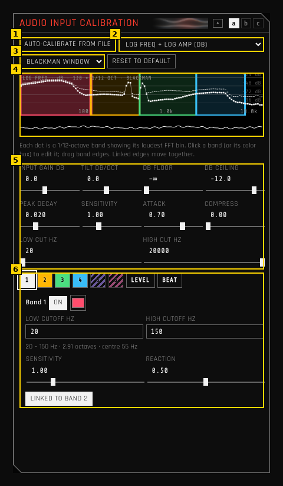

| # | Control | Use |
|---|---|---|
| 1 | Auto-calibrate from file | Sets the input gain so the loaded file peaks at −1 dBFS, then sets the dB ceiling from its loudest band (never above 0 dB). The floor is left alone. |
| 2 | Spectrum display | Same setting as in the visualizer bar, for the selected layer. |
| 3 | FFT window | Blackman or Hann. |
| 4 | Spectrum graph | Each dot is a 1/12-octave band showing its loudest FFT bin. The coloured areas are the reactive bands. |
| 5 | Processing | Input gain, tilt, dB floor and ceiling, peak decay, sensitivity, attack, compress, low and high cut (see [Calibration](#2-calibration)). |
| 6 | Bands | Up to six reactive bands, plus **Level** and **Beat**. Each band has on/off, colour, low and high cutoff, sensitivity, reaction, and linking to its neighbour. |

- **Editing bands:** click a band (or its colour box) to edit it, and drag band edges on the graph. Linked edges move together.
- **Bands as sources:** the bands are the reactive sources offered in Variable Matrix.

### Variable Matrix [DNA]

| # | Control | Use |
|---|---|---|
| 1 | DNA view | The helix spins and focuses on a strand as you edit settings. |
| 2 | Category | Motion, Noise, Volume, Shape, Transform, Look, Camera, Vision, FX, Grid, Custom, Video, Wiki. |
| 3 | Reset to default | Resets the settings in the current category. |
| 4 | Setting | **Base** value, a **source** and an **amount**. |

**Reactivity.** A setting with a source moves by *source × amount × its range* around its base value.

- **Sources:** Level, Beat, Red (bass), Green (mids), Blue (treble), the reactive bands, and the four stems once they are split.

**Categories:**

- **Motion:** wave height, time span, time fall-off.
- **Noise:** noise warp, scale, speed.
- **Volume:** width (Y frequency), height (X amplitude), depth (Z time), spread, time length.
- **Shape:** bend, tunnel twist and end wiggle. See [Shape](#shape).
- **Transform:** move, turn and spin about each axis.
- **Look:** blend mode (Screen by default) and what it applies to, dot density, sphere size, size by volume, opacity, glow, glow time fall-off, brightness, saturation, band gradient mix, band crossover, line opacity.
  - **Blend mode:** Additive, Screen, Normal, Lighten, Multiply or Subtract. **Applies to:** Spheres (the default, as before), Lines, or Spheres and lines. What it doesn't apply to keeps its own blending: spheres Screen, lines additive. Normal hides what is behind; Multiply and Subtract darken, so they show over bright layers or effects. Lines draw when the grid style is lines, or dots and lines. Set per layer and saved in presets.
  - **Glow** is stored with the points and lines drawn at that moment. A glow burst lights only that slice, and the slice keeps its glow as it moves back along the time axis.
  - **Glow time fall-off** sets how fast that glow fades as it ages.
- **Camera:** zoom, field of view, auto orbit, elevation offset, roll, shake.
- **Vision:** the Krack'd Vision sliders.
- **FX:** the parameters of the filters that are turned on.
- **Grid:** dot counts on Y (frequency) and Z (time), helix and spiral turns, Volume levels (4 to 24 loudness steps, 10 by default), and the wrap seam for tunnel, sphere and ring.
  - Mirror puts low frequencies at the seam and high frequencies opposite it.
  - Crossfade gives one full 20 Hz – 20 kHz sweep.
- **Custom:** the image for the Custom form, per layer.
  - Float value uses brightness as elevation; RGB value uses R, G, B as Y, X, Z positions.
  - Backdrop shows the image behind the points.
  - Build spectrum drives the layer from the image instead of the audio.
- **Video:** see [Video lanes](#video-lanes).
- **Wiki:** see [Wiki layer](#wiki-layer).

Any value can be typed: click the number.

#### Shape

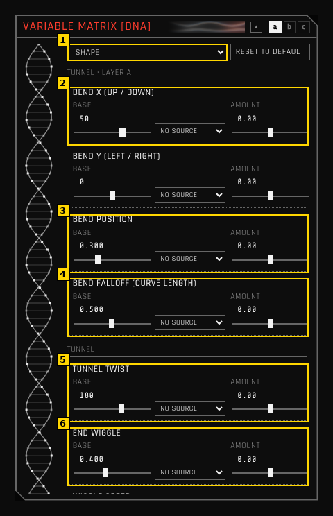

Bend works on the forms with a length: Volume, Plane, Tunnel and Helix. The tab shows only the settings that apply to the selected layer's form, and every one can follow the music.

| # | Setting | Use |
|---|---|---|
| 1 | Category | **Shape** in the category list. |
| 2 | Bend X / Bend Y | Volume, Plane, Tunnel and Helix run front to back along Z. **Bend X** curves them up or down, **Bend Y** left or right. |
| 3 | Bend position | Where the curve starts, from the front (newest) end. |
| 4 | Bend falloff | How much of the length the curve takes. A short falloff gives a tight corner. |
| 5 | Tunnel twist | Tunnel only. Turns the grid along the length, in degrees from front to back. |
| 6 | End wiggle, Wiggle speed | Tunnel only. Sways the far end. |

- **Walls:** there is no separate Wall form. Stand the Plane up with a camera view and it is a wall; Bend X with the position near the end gives a cyc wall. Presets saved with the old Wall form load as Plane.
- **Bends combine:** X and Y together bend along one diagonal arc.
- **Tunnel view:** look down the tunnel with the Front view and bend it to make it turn.

### Krack'd Vision

A kaleidoscope filter over the visualizer. It is applied **before** Krack'd FX, both live and in the export.

| # | Control | Use |
|---|---|---|
| 1 | On/off, Randomize, Reset | Turn Vision on or off, randomize it, or restore every setting. |
| 2 | Presets | Save, name, recall and delete Vision looks. |
| 3 | Styles | Geometry, mode, projection, loop, time, speed, retro. |
| 4 | Sliders | Segments, rotation, auto rotate, zoom, auto zoom, loop rate, centre, twist, pattern mix, effect mix, trails, tunnel speed. |

### Krack'd FX

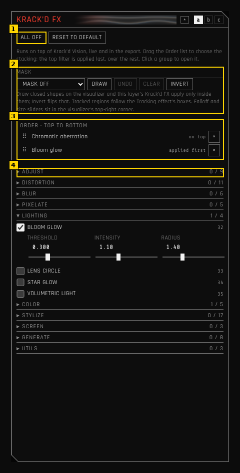

These are post filters, run on top of Krack'd Vision, both live and in the export. The catalogue is a grouped, sorted list of 71 filters in ten groups: Adjust, Distortion, Blur, Pixelate, Lighting, Color, Stylize, Screen, Generate and Utils.

| # | Control | Use |
|---|---|---|
| 1 | All off, Reset to default | Turn every filter off, or restore every filter's settings. |
| 2 | Mask | Draw closed shapes on the visualizer, and the layer's FX apply only inside them. |
| 3 | Order | Drag to set the stacking. The top filter is applied last, over the rest, like the layer list. |
| 4 | Groups | Click a group to open it. |

**Mask:**
- **Invert** flips the masked area.
- **Tracked regions** follow the Tracking effect's boxes.
- **Falloff and size** sliders sit in the visualizer's top-right corner. The falloff is smooth so that soft effects have no hard edge.
- **Video:** a video can also act as the mask (see [Video lanes](#video-lanes)).

### Color Palette Select

These are the colours used by layers set to **Palette colour**. Pick a preset, edit the swatches, and save named palettes. The interface itself takes its colours from Krack'd Theme. The video lanes take their identifying colours from palette colours 2–4.

### Krack'd Theme

| # | Section | Use |
|---|---|---|
| 1 | Theme | Interface theme and an accent colour. 25 themes: the originals (MONO, SIGNAL, ACID, CYAN, MAGENTA, AMBER, PAPER) and 18 after widely used editor and terminal themes (DRACULA, ONE DARK, NIGHT OWL, TOKYO NIGHT, CATPPUCCIN, NORD, GRUVBOX, MONOKAI, AYU, SOLARIZED, SYNTHWAVE, PURPLE, COBALT, PALENIGHT, ROSE PINE, EVERFOREST, KANAGAWA, GITHUB). Each has four theme colours used by the planets, log bar and cursor. |
| 2 | Font accent | Picks the title colour from the theme's own palette, or lets you choose your own. |
| 3 | Header animation | The animated strip at the right of every module header, in the theme's colours. |
| 4 | Target cursor | A dot and four corner brackets that frame the **module** under the pointer. Mouse and trackpad only. The system cursor stays visible by default. |
| 5 | Setting highlight | Frames the **setting** under the pointer inside a module. The game strip is excluded. |
| 6 | Log bar | Colours, motion and reactivity of the header log bar. |
| 7 | Motion | Module scaling, header strips and logo pulse. By default this follows the system's reduced-motion setting. |
| 8 | Logo | The header logo reacts to the selected layer's audio: hue steps on each beat, and the glow follows the level. Off by default: the logo stays still until the first tap, reacts while the startup mix is the track, and after that only when switched on here. |

The target cursor and the setting highlight give two levels of feedback: which module you are in, and which setting you are on. Both use the theme's colours.

### Timeline & Waveform

| # | Control | Use |
|---|---|---|
| 1 | Input | Demo, Mic, Tab audio, or an audio file. The startup mix loads on the first click or key press, unless you pick another input first, and plays once. |
| 2 | Transport | Play/Pause, Loop, Clear loop. |
| 3 | Split stems / Model files… | Spleeter 4-stem split (see [Stems](#stems)). Model files… loads the Spleeter and Whisper model files from your computer for fully offline use, for this session. |
| 4 | Drive visuals / Save stems / Audio input preview | **Drive visuals:** the stem mix drives the picture instead of the full mix. **Save stems:** writes the stems to files. **Audio input preview:** lets you hear the stem settings (exports always use the full mix). |
| 5 | Lyrics | Opens the lyrics editor (see [Lyrics](#lyrics)). |
| 6 | Game | Shows or hides the mini game strip. |
| 7 | Ruler | Drag to scrub. It shows the whole track and marks the zoomed window. |
| 8 | Mix | RGB waveform of the track, with the output volume. The zoomed window is outlined. |
| 9 | Stem lanes | Drums, vocals, other, bass, each with volume, **M** (mute) and **S** (solo). They appear only after a split. |
| 10 | Zoom ruler | Zoom level, **−**, **+**, **Fit** and **Snap**. See [Zoom and snap](#zoom-and-snap). |
| 11 | Video lane | V1–V3 (shown here with keyframes open). |
| 12 | **+** | Opens the keyframe curves for this lane. |
| 13 | Keyframed setting | Chooses which setting the curve edits. |
| 14 | ♪ | Adds the clip's audio to the output. |
| 15 | A B C | Routes the clip to a layer, for preview and export. |
| 16 | Camera lane | **+ Key**, **Path**, **↻ / ⇄** (loop / ping-pong) and **×** (clear). See [Camera path](#camera-path). |

**Basics:**
- Drag across any lane to set a loop.
- Drop an audio file anywhere in the module to load it.
- When the Export module is folded, the timeline uses the full width.

#### Zoom and snap

The zoom ruler, video lanes and camera lane zoom together. The mix lane, stem lanes and top ruler stay a full-length overview with the zoomed window marked.

| Action | Keys and gestures |
|---|---|
| Zoom in / out around the playhead | `=` / `−`, or the **+** / **−** buttons |
| Zoom around the pointer | Alt + scroll or Ctrl + scroll over a zoomed lane (trackpad pinch on a Mac) |
| Fit the whole track | `\` or Shift + Z, or **Fit** |
| Pan | Shift + scroll, a sideways trackpad swipe, or Shift-drag on the zoom ruler |
| Phones and tablets | Pinch to zoom, two fingers to pan |
| Scrub | Drag on the zoom ruler |
| Frame snap on / off | `S`, or **Snap** |
| Free edit while snap is on | Hold Alt |

- **Zoom ruler labels:** seconds plus frames at 30 fps, for example `0:06 +10f`. Frame ticks show when zoomed in far enough.
- **Snap:** keyframes, clip moves and trims, loop drags and camera keys land on whole frames at 30 fps. Snap is on by default, and the setting is remembered in this browser.
- **Playback:** while playing zoomed in, the view follows the playhead when it runs off the edge.
- **Mini game:** the shortcuts are ignored while the game is being played, because it uses W A S D.

#### Camera path

The **Cam** lane under the video lanes keyframes the camera, in palette colour 5.

- **Adding keys:** frame a view in the visualizer, put the playhead where it belongs, and press **+ Key**. A key stores the orbit angle, elevation, distance and pan. Pressing **+ Key** at an existing key's frame updates that key.
- **Bracket:** keys sit inside a bracket and are timed relative to it.
  - Drag a key to retime it.
  - Drag an end of the bracket to stretch the whole move.
  - Drag the middle of the bracket to shift it.
  - Double-click or right-click a key to delete it. Click a key to jump to it.
- **Playback:** inside the bracket the camera follows a smooth path with no overshoot, and Auto orbit pauses. Outside the bracket the camera is free.
- **↻ / ⇄:** the button cycles through three modes:
  - **Off:** the path plays once, inside its bracket.
  - **Loop ↻:** the path repeats over the whole timeline.
  - **Ping-pong ⇄:** the path plays forward, then backward, over the whole timeline.
- **Moving the camera yourself pauses the path.** While playing, the camera eases back to the path when you let go. While stopped, it waits until you move the playhead, so you can frame the next key. The lane shows PAUSED while this is happening.
- **Path:** draws the route as dots in the viewport. It is never included in exports. The route runs at the camera's own distance, so scroll the view out to see all of it.
- **× Clear:** removes every key.
- **Saving:** the path is saved with each preset.

#### Stems

- **Engine:** Spleeter 4-stem (Deezer, Apache-2.0), split into drums, vocals, other and bass.
- **Where it runs:** on this computer, in background workers, several blocks at once across your CPU cores. A full song takes seconds.
- **Models:** about 79 MB, fetched when you split and kept in memory for this session only. Nothing is saved in the browser; a second split in the same session reuses them, and the next session fetches them again. Each file is checked against its SHA-256 before use. Copies saved by earlier versions are deleted.
- **What stems change:** only what drives the visuals. Stems can also be sources in Variable Matrix.
- **Why Spleeter only:**
  - HT-Demucs was tried. On the CPU it took about 8 minutes per song, and its GPU path did not work reliably in browsers.
  - A fast estimate mode was also removed.
  - Spleeter's accuracy was judged sufficient.

#### Video lanes

| Item | Behaviour |
|---|---|
| Files | MP4 or WebM, up to 1 GB, so the clip's audio can still be decoded in memory. |
| Loading | Click an empty lane or drop a file on it. Files open locally (blob URLs) and are never uploaded. |
| Trim and place | Drag the bars at the ends of a clip to trim it. Drag the middle to move it on the timeline. |
| Routing | A / B / C at the lane's top right. Loading a clip switches its layer to Video and turns the layer on. |
| As a layer | A routed clip is a full layer. It blends with the layer blend modes and takes Krack'd Vision and Krack'd FX. |
| Sync | Clips play muted, locked to the timeline clock, with small drift corrected by playback rate. Larger jumps seek. |
| Clip audio | The ♪ toggle and level slider add the clip's own audio to the output, to the input that drives the visuals, and to exports. |
| No audio track | If a video is loaded with no audio track, a silent track as long as the clips keeps the timeline running. |
| Phones | The preview picture is drawn at a maximum of 480 px. |

**Variable Matrix › Video** (per layer):

- **File info:** name, resolution, frame rate, length, trim, place on the timeline, size, audio.
- **Layer shows:** Waveform or Video, and **Fit** (Contain, Cover, Stretch).
- **Move, Scale, Rotate, Opacity, Brightness.** Each can follow the music or be keyframed. Move and Scale are in picture heights.
- **FX mask:** the clip masks the layer's Krack'd FX.
  - **Luminance** mode applies the FX where the video is bright. **RGB** mode applies it per colour channel.
  - **Invert** flips the mask.
  - The mask works whether the layer shows the waveform or the video.

#### Keyframes

- **Open:** press **+** at the start of a video lane to open a curve editor on that lane.
- **What can be keyframed:** the dropdown under the lane's audio slider lists the Krack'd FX settings that are on, the Krack'd Vision settings (when Vision is on), and the Video settings of the layer the lane is routed to.
- **Editing:**
  - Click to add a point.
  - Drag a point to move it.
  - Double-click or right-click a point to delete it.
- **Curves:** smooth, with no overshoot between points.
- **How a curve applies:** it sets the setting's base value over time. Reactivity still adds on top.
- **Colours:** each lane has a palette colour. Keyframed settings show a stripe in that colour in Variable Matrix and Krack'd FX, including on a closed FX group's header.
- **Snap:** points land on whole frames while snap is on. Hold Alt for a free edit.
- **Saving:** keyframes and lane routing are saved with each preset.

#### Mini game

- **When it appears:** the strip opens at the bottom of the module while stems split or the track plays. The **Game** button hides it independently of playback.
- **Room:** on desktop the strip opens inside the Timeline module and never takes height from the visualizer. While it is open it covers the lower lanes; the **Game** button closes it when you need them.
- **Phones:** the game gets its own **Mini game** module at the bottom of the module stack, so you find it by scrolling down through the modules. It appears while the strip would be open. As it appears, one faint ripple with dither runs up the whole app from the bottom of the screen, with the same timing and fall-off as the blast-off shockwave. There is no ripple when it first opens for the start-up track. **Hide** puts it away (the same as the **Game** button).
- **Heads-up on phones:** when the module opens below the screen, the bottom edge of the screen glows in the theme accent, fading in and slowly breathing, until you scroll to it. Then the module's rim pulses twice (about a second each) and the edge glow follows the same rhythm, fading out on the last pulse so both end together. Already on screen: only the rim pulses.
- **Start:** before a game starts, only the terrain, the background and **GAME START** show.
- **Controls:**
  - W A S D move, K fires, Esc ends the game.
  - On touch screens, drag to steer and the ship fires while your finger is down.
- **Scene:**
  - A side-scroller with an isometric tilt.
  - A 3D grid sits behind three terrain ridges driven by the bass, mids and highs of the playing audio.
  - Stars and planets drift behind at different speeds.
- **Ships:** one of six is picked at random, each with its own speed, fire rate and maximum power.
- **Enemies:** 12 types plus a boss, with randomised speed, fire rate, size and strength, and some tougher elites. They fire back.
- **Hazards:** comets and galaxies can't be shot down. Galaxies pull the ship in.
- **Power-ups:**
  - heart: power
  - lightning: rapid fire
  - ring: shield
  - coin: points
  - **?**: a random bonus
- **Power and radar:**
  - The power bar drains by the strength of whatever hits you.
  - The radar shows enemies, hazards and power-ups before they enter the strip.
- **Scoring:**
  - Points per kill, with a combo multiplier up to ×8, plus points for survival time and coins.
  - Reaching the end of the track shows YOU WIN with a bonus.
  - The high score is stored in this browser.

### Lyrics

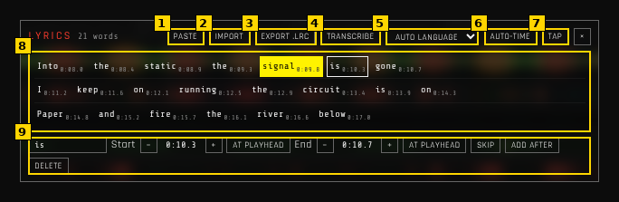

The words of the vocal, each with a start and end time. They drive [Wiki layers](#wiki-layer). **Lyrics** in Timeline & Waveform opens the editor as a dropdown over a frosted blur, like the log readout; on phones it is as wide as the modules.

| # | Control | Use |
|---|---|---|
| 1 | Paste | Paste the words, one sung line per line. |
| 2 | Import | `.txt` (words only), `.lrc` (line times, and word times in `<mm:ss.xx>` tags) or `.srt` (cue times). Words between two known times are spread by syllable count. |
| 3 | Export .lrc | Saves the lyrics with a time for every word. |
| 4 | Transcribe | Whisper writes the words with their times from the vocal (see below). Press again to stop. |
| 5 | Language | **Auto language** (detected from the first piece) or one of 32 languages. |
| 6 | Auto-time | Times the words you have from the audio: finds where the vocal is active and where syllables start, spreads the words by syllable count and snaps each to the nearest syllable start. |
| 7 | Tap | Play the track and tap (or press **T**) as each word starts. Taps start at the selected word. |
| 8 | Word list | Every word with its start time, by line. The word being sung is marked in the Wiki marker colour as the track plays. Click a word to jump the playhead to it and select it. |
| 9 | Selected word | Edit the text; nudge the start or end by 0.05 s or set it to the playhead; **Skip** (the previous word stays on screen); **Add after**; **Delete**. |

- **Source:** Transcribe and Auto-time use the vocal stem when stems are split (much cleaner), otherwise the mix. With a loop range set, they work only inside it.
- **Saving:** the lyrics are kept in this browser with the track name. Esc or a click outside closes the editor.

#### Transcribe

- **Model:** Whisper base (OpenAI, MIT), the timestamped ONNX export (onnx-community/whisper-base_timestamped, 8-bit): an encoder and a decoder (about 77 MB) and the vocabulary (1 MB). Handled like the Spleeter models: fetched when you transcribe, checked against published checksums, kept in memory for this session only (see [Hosting and model files](#hosting-and-model-files)).
- **Where it runs:** on this computer, in background workers on the same verified ONNX Runtime as the stem split (up to two workers on desktop, one on phones). The audio never leaves the computer.
- **Pieces:** the vocal is cut into pieces of up to 30 seconds at its quietest moments. Parts with no singing are skipped. Words appear in the list as each piece finishes.
- **Word times:** each piece is turned into Whisper's log-mel features and decoded word piece by word piece. The attention of the eight heads Whisper uses for alignment, matched to the audio with dynamic time warping, gives each word its start and end, as in OpenAI's own word timing. The first word of a piece starts no earlier than the singing.
- **Guards:**
  - Non-speech symbols such as ♪ are suppressed.
  - A phrase repeating in place (a known Whisper failure on held notes or after the singing ends) stops the piece. Lyrics that really repeat move on through the audio and are kept.
  - When Whisper ends a piece before the singing does, the rest is transcribed again on its own.
  - If no word times come back, the words are timed with Auto-time instead.
- **Your own words:** with lyrics already in, Transcribe asks: **Keep my words, take the timing** lines your words up with what Whisper heard (exact and close spellings match), gives matched words the heard times and spreads the rest between them; **Replace with the transcription** swaps them for what was heard.
- **Accuracy:** Whisper base is small and fast. Clear singing transcribes well; heavily processed or chopped vocals will have misheard or missed words. Check by playing and fix in the editor.

### Wiki layer

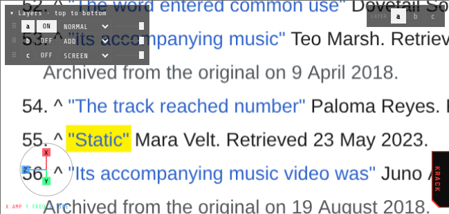

A layer source that fills the frame with encyclopedia pages, cutting to a new page on every sung word, with the word marked by a highlighter. Set a layer's source to **Wiki** in the visualizer; the settings are in Variable Matrix › Wiki.

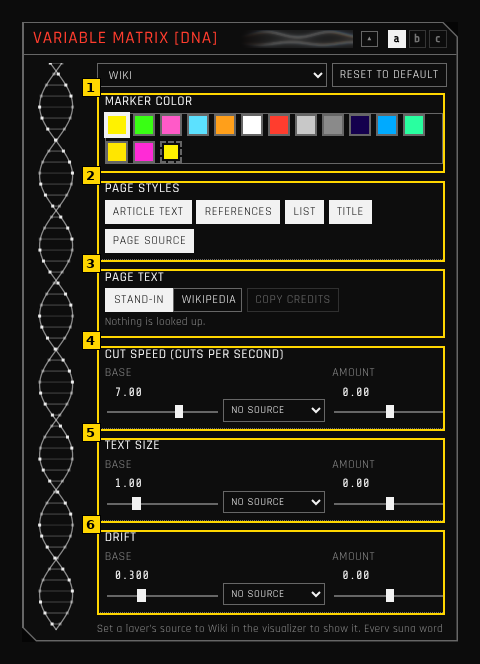

| # | Setting | Use |
|---|---|---|
| 1 | Marker color | Five highlighter colours (yellow, green, pink, blue, orange), the theme and palette colours, or any colour. Also marks the current word in the Lyrics editor. |
| 2 | Page styles | Which layouts a cut can pick: Article text, References, List, Title, Page source. At least one stays on. |
| 3 | Page text | **Stand-in** (default: made-up encyclopedia text around the word, never online) or **Wikipedia** (real article text, see below). **Copy credits** copies the list of articles shown. |
| 4 | Cut speed | 1 to 10 cuts a second (7 by default). Every new word cuts; between words it keeps cutting at this speed. Cuts are hard, with no blur. |
| 5 | Text size | Zooms the page. |
| 6 | Drift | A slow push in or out on each cut. |

- **The word:** the lyric being sung (skipped words keep the previous one). With no lyrics, stand-in words show so the layer can be previewed. Article text keeps the marked word near the middle of the frame; the other layouts start at a page margin like a real page.
- **A layer like any other:** it takes the layer's blend mode, Krack'd Vision and Krack'd FX, live and in exports. Cut speed, Text size and Drift can follow the music like any variable.
- **Light:** a page is drawn once per cut, only the lines on screen, into one small canvas per layer, capped at 1280 px (720 on phones, 1920 for exports). Between cuts only the zoom and drift change. Typesetting a page takes about 0.4 ms.

**Wikipedia page text** (off until you pick it):

- **What is sent:** only the lyric word, to Wikipedia's public API (en.wikipedia.org), with no cookies and no referrer. That one address is the only addition to the app's network allowlist.
- **What comes back:** a few article titles and the sentences that contain the word, from the top matching articles; if none of them contains it, short passages around it. Words with no match keep the stand-in text. The text is only ever drawn on the canvas, never added to the page as HTML.
- **Order:** lookups run in a background worker, two at a time with a short gap, in the order the words are sung from the playhead; the word on screen and the next three go first.
- **Kept:** up to 250 looked-up words in this browser. Re-launch clears them with the other settings.
- **Unreachable:** after three failed lookups in a row they pause and stand-in text is used; pick Wikipedia again to retry.
- **Credits:** Wikipedia text is licensed CC BY-SA 4.0. Every video export that showed it is saved with a `_wikipedia-credits.txt` file next to it, listing the licence and each article with its link; **Copy credits** gives the same list.

### Export Module

| # | Control | Use |
|---|---|---|
| 1 | Save location | File name. **Browse** picks where to save, in browsers that support it. |
| 2 | Format | MP4 (H.264 + audio), MOV (H.264 + PCM, for editors), animated WebP, GIF. |
| 3 | Aspect ratio / Resolution / Frame rate | 16:9, 9:16, 1:1, 4:3, 4:5, 21:9 · 480p to 1440p · 24, 25, 30, 50, 60 fps. |
| 4 | Duration | **Loop** matches the loop, or the whole track when no loop is set. Otherwise type a length in seconds. |
| 5 | Include grid | Includes the workspace grid in the render. |
| 6 | Import to Resolve | Also writes a DaVinci Resolve timeline (.fcpxml) next to an MP4/MOV, with matching frame rate, resolution and length, the audio, beat markers, and split stems on their own tracks. In Resolve, use File › Import › Timeline. |
| 7 | Preview | Opens a preview window that sizes itself to the window. |
| 8 | Export render | Renders the export. |

- **What is exported:** only the visualizer, with no interface.
- **How it renders:** in real time against the playing timeline. Video lanes, keyframes and clip audio are included.
- **MP4 is one complete file** with the audio inside:
  - **AAC** at 96–192 kbps, the range every platform encoder accepts.
  - **Opus** where the browser has no AAC encoder. It plays in Chrome, Edge, Firefox, VLC and the Windows player. The finish message says when Opus was used.
  - A WAV copy is written next to the MP4 only when the audio is Opus and **Import to Resolve** is on, because Resolve can't read Opus. If a browser can encode neither, the audio is saved as a WAV.
- **MOV:** uses PCM audio for compatibility with editing software.
- **Highest resolution:** 1440p. Exports render in real time, and 4K could not be kept clean.
- **Repeated frames:** if rendering can't keep up with the frame rate, frames are repeated. The finish message says how many, so you know when to lower the resolution or turn off some Krack'd FX.
- **Wikipedia credits:** a video that showed Wikipedia text is saved with a credits file next to it (see [Wiki layer](#wiki-layer)).
- **Folding:** the ▸ button folds the module to a slim tab on the right, so the timeline gets the full width.

### Header

| # | Item | Use |
|---|---|---|
| 1 | Logo | Reacts to the startup mix; after that, only when switched on in Krack'd Theme › Logo. |
| 2 | Log bar | Status readout. See below. |
| 3 | Preset manager | Save, name and recall presets, share them as codes, export or import the whole set. |
| 4 | OSC | Map settings to an outside OSC controller. |
| 5 | Re-launch | The rocket button. Start over as on a first visit. See below. |

**Log bar**

- **New status line:** the game's rocket flies across the header and uncovers a faulty-terminal effect as it goes: a grid of flickering glyphs in the theme colour with scan lines, glitches, a light ghosting and slow trails. Glyphs near the rocket brighten, ripple and scramble faster. The text writes out 20 px behind the uncovered part. Near the end of the bar the rocket shrinks smoothly to 20%, as if flying into the interface, and is gone at the Preset manager button. Clicking the bar degausses the effect.
- **Full readout:** click the log bar (it highlights on hover) to drop down the whole log, live: every status line, Release the krack change, error and start-up step as it happens, newest at the bottom. It follows new lines while you are at the bottom and stays put while you read further up. Show all lines, only changes, or only problems; **Copy** puts the shown lines on the clipboard; **Download** saves the debug log file. The readout is 70% opaque over a frosted blur with faint scan lines, and on phones it is as wide as the modules. Click the bar again, click outside, press Esc or × to close it.
- **Same line updating** (only numbers change, such as timers and percentages): the terminal glows to the right of the text instead of relaunching the rocket. It lingers for 12 seconds after the last line (Theme › Log bar › Effect hold), then fades.
- **Progress:** a percentage in the line fills a progress rule under it.
- **Text colour:** the theme colour with the most contrast against black, with no shadow, so the small letters stay crisp.
- **Motion:** by default the rocket flies even when the system asks for reduced motion. Theme › Log bar › Motion can make it follow the Motion setting instead.

**Preset manager**

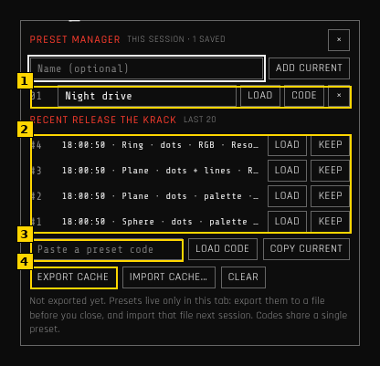

| # | Part | Use |
|---|---|---|
| 1 | Saved presets | Load, rename, copy the code of, or delete each preset. |
| 2 | Recent Release the krack | The last 20 presses, with **Load** and **Keep**. |
| 3 | Preset codes | Paste a code and **Load code**, or **Copy current** to share the current state. |
| 4 | Cache file | **Export cache**, **Import cache…**, **Clear**. |

- **Contents:** a preset holds all three layers, plus video-lane keyframes and routing, and the camera path.
- **Naming:** presets are numbered by default and can be named.
- **Codes:** a single preset can be shared as a text code.
- **Cache file:** the whole set can be exported to a file and imported in a later session. Presets otherwise live only in the current tab.
- **Recent Release the krack:** the last 20 presses, with **Load** and **Keep**. See [Release the krack](#release-the-krack).
- **Deleting:** a preset or the cache is deleted only after an "Are you sure" confirmation.
- **Loading codes:** codes and files are checked on load. Unknown or out-of-range values are dropped or clamped.

**OSC**

- **Bridge:** a custom module for **Open Stage Control** (free, open source). Nothing else needs installing.
- **Coverage:** every variable, every Krack'd FX switch and parameter, the Krack'd Vision settings, and the colour settings, for each layer.
- **Address format:**
  - `/kk/a/var/waveH`
  - `/kk/b/fx/bloom/intensity`
  - `/kk/a/vision/geo`
  - `/kk/palette/1`
- **Values:** sent in real units or as 0–1.
- **Feedback:** when on, changes made in the app move the controller's faders.
- **Address list:** downloads every address with its type and range.
- **Bridge security:**
  - It listens only on your computer (127.0.0.1).
  - It accepts only this app, opened from a file, from your computer, or from the hosted site.
  - A pairing code is required within 30 seconds.
  - Only published addresses with numbers or colours are relayed, and the message rate is limited.
  - Nothing received can run code or touch files.
- **Setup:** in Open Stage Control, set **custom-module** to the bridge file and **load** to the layout, then press **Start**. Type the pairing code into the OSC panel and press **Connect**.
- **Phones and tablets:** the OSC button is hidden on phones. A phone or tablet can still be the controller through Open Stage Control's own web page.

**Re-launch**

The rocket button flips to the word RE-LAUNCH on hover. It asks first; then the little rocket flies off to the right and the app reloads as on a first visit. Every setting the app saved in this browser is cleared (layers, theme, saved palettes and Vision presets, folded modules, lyrics, looked-up Wikipedia words, the mini game high score). To keep your presets, export them from the Preset manager first.

**Timing:** a reload can't be animated across: the old page stops the moment it goes. So the old page hands the fresh one what it needs, and the fresh page plays the blast-off from its very first frame, while the app is still starting underneath:

- **Rocket:** the big Release the krack rocket, with its random path, size changes, pixel fire and explosion, crosses the whole app (from the bottom up on phones). It is drawn by the rocket's own code in a background worker, so the app loading can't stall it.
- **Rumble:** every module shakes from the first frame, the same press-by-press rumble as Release the krack.
- **Ripple:** it needs the app itself, so it joins as soon as the app is up, already as far along as it would be, in step with the rocket.
- **No black wipe**, on any device.
- **Older browsers:** where a worker can't draw (Safari before 16.4), the same blast-off plays as soon as the app is up.

**Debug log**

- **Download:** from the log readout (click the log bar, then **Download**).
- **Storage:** kept in memory only.
- **Contents:** the download includes the environment, capabilities, current settings and every logged event.
- **Privacy:** nothing leaves the computer unless you download the log and share it.

---

## Interface behaviour

| Behaviour | Detail |
|---|---|
| Hover scaling | The module under the pointer grows and the others in its column shrink, with no gap left. It starts immediately on hover and takes 0.2 s. It is off on touch screens and narrow windows. |
| Minimize (1, 2) | Side modules roll up to their header with ▴. The other modules in the column take the space. Click anywhere on a minimized module's header to open it again; the header's own buttons keep their jobs. |
| Fold Export (3) | ▸ folds Export to the right, so the timeline gets the full width. |
| Remembering | Minimize and fold states are remembered in this browser. The first visit opens with Krack'd Vision, Krack'd FX, Color Palette Select, Krack'd Theme and Export minimized. |
| Typed values | Click any number to type a value. On hover the number turns the theme's contrast colour. While typing, a thin box frames it, and the box fades out when the pointer leaves. |
| Motion | Animations follow the system's reduced-motion setting unless Theme › Motion overrides it. |

The 3D visualizer, Export and Timeline modules can't be minimized by height. Export folds to the right instead.

---

## Mobile

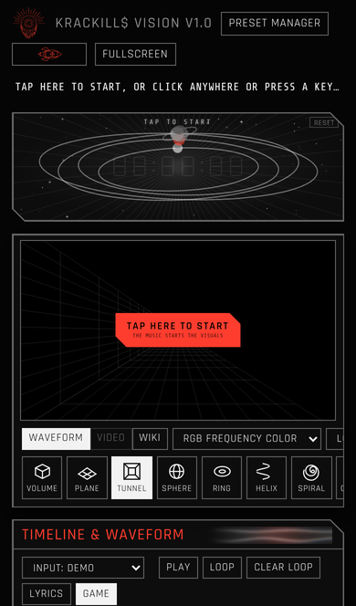

| Item | Phone behaviour |
|---|---|
| Layout | Modules are stacked in one column. **Session** comes first and **Timeline & Waveform** sits directly under the visualizer, so the input and transport are reachable without scrolling; the other modules follow. **Pinned** (inside the visualizer window, top right) keeps the visualizer at the top while the modules scroll. The page never scrolls sideways. |
| Header strips | Each module's animated strip stays locked to its own module. |
| Stem tools | Split stems, Model files, Drive visuals, Save stems and Audio input preview are hidden on phones. |
| OSC | The OSC button is hidden on phones. |
| Video | The preview picture is drawn at a maximum of 480 px. |
| Release the krack | Same module in the visualizer's lower right corner, sized for a thumb. The rocket and blast play and every module shakes; instead of the shockwave (which the pinned visualizer can't take cleanly), one ripple runs up the app from the bottom of the screen. |
| Re-launch | The rocket, ripple and rumble run from the bottom of the screen up. |
| Lyrics | The editor is as wide as the modules and opens above or below the button, wherever it fits. Transcribe runs in one worker. |
| Timeline zoom | Pinch to zoom, two fingers to pan. |
| Hover effects | Hover scaling, the target cursor and the setting highlight are off on touch screens. |
| Game | Its own **Mini game** module at the bottom of the module stack, appearing with one faint ripple up the app, and a glow on the bottom edge of the screen until you scroll to it. Touch controls: drag to steer, auto-fire while touching. |

---

## Security and privacy

| Measure | Detail |
|---|---|
| Local processing | Audio, video and images are read from your computer and never uploaded. |
| Content Security Policy | Connections are allowed only to your own computer (OSC), this site, the pinned runtime path on jsDelivr, the repository's raw files, the Spleeter and Whisper model folders on Hugging Face, and Wikipedia's API address (used only when Wiki › Page text is set to Wikipedia). |
| Runtime integrity | ONNX Runtime Web 1.31.1 files are checked with SHA-256 (SRI) before use. |
| Model integrity | Each Spleeter and Whisper model must match its published SHA-256 and size, whatever its source (the Whisper vocabulary, its git object id). A changed file is refused. |
| Models in memory | Model files are kept in memory for the session only. Nothing is written to the browser's storage, and the requests skip the browser's download cache. |
| Wikipedia | Off by default. When on, only the lyric word is sent, with no cookies or referrer. Replies are read in a worker and drawn only on the canvas, never inserted as HTML. |
| Embedded libraries | three.js r128 (unchanged) and the fonts are embedded in the file. |
| Settings | Stored only in this browser (localStorage): settings, lyrics, looked-up Wikipedia words. |
| Presets | Codes and files are checked on load, so unknown keys and out-of-range values are dropped or clamped. |
| OSC | See [OSC](#header). |

---

## Hosting and model files

| Item | Detail |
|---|---|
| `index.html` | The app. |
| `vocals / drums / bass / other.fp16.onnx` | Spleeter 4-stem models (about 19.7 MB each). |
| `whisper-base/encoder_model_quantized.onnx` | Whisper base encoder, 8-bit (23.2 MB). |
| `whisper-base/decoder_model_merged_quantized.onnx` | Whisper base decoder, 8-bit (53.7 MB). |
| `whisper-base/vocab.json` | Whisper vocabulary (1 MB). |

The app looks for each model in this order, and checks every copy against its checksum:

1. **The site the page is served from.** On GitHub Pages, `index.html` sits next to the Spleeter models and the `whisper-base` folder.
2. **This repository's raw files** (main branch), for copies opened from a file. The checksums, not a commit, guarantee the files.
3. **Hugging Face**, as a last fallback, pinned to a commit.

Models are fetched when a tool runs (Split stems, Transcribe) and kept in memory for that session only. The ONNX Runtime files (about 12 MB) are fetched from jsDelivr, pinned to version 1.31.1 and checked with SRI.

To host your own copy:

- Put the files above in the repository root, with the same names. Upload them as normal files, not with Git LFS: GitHub Pages serves LFS files as small pointer files, which fail the checksum.
- Enable GitHub Pages: **Settings › Pages › Deploy from a branch › main › / (root)**.

---

## Roadmap

- Updates as feature requests and bug reports come in.
- More theme and reactive element options.
- More waveform modes, with settings for each.
- Lyrics as keyframes on the timeline, and a Lyric reactivity source (a pulse on every sung word).
- An offline dictionary (Open English WordNet) as a Wiki page text option that never goes online.

---

## Credits and licences

| Component | Licence |
|---|---|
| KracKill$ Vision | See `LICENSE` (Apache-2.0) |
| Spleeter models (Deezer) | Apache-2.0 |
| Whisper base (OpenAI), ONNX export by onnx-community | MIT |
| Wikipedia article text (only when Wiki › Page text is set to Wikipedia) | CC BY-SA 4.0: credits saved with each export |
| ONNX Runtime Web | MIT |
| three.js r128 | MIT |
| Rajdhani (Indian Type Foundry), Share Tech Mono (Carrois Type Design), via @fontsource | SIL Open Font License 1.1 |
| DSEG7 Classic Light (keshikan), session clock digits | SIL Open Font License 1.1 |

Game sprites were supplied by the project owner and traced to vector outlines.

The interface effects were written for this app after these references:

- React Bits Target Cursor, Tech Text and Faulty Terminal
- React Bits Pro Twilight Lines

---

## Get involved

KracKill$ Vision is free and ongoing. If you build presets you are proud of, share them as preset codes or a cache file from the Preset manager: good ones may ship as built-ins in future updates. Bug reports (with a debug log from the log readout's Download, if you can), feature requests and general positivity are all welcome. Open an issue at [github.com/whatiphmedia/KracKill-Vision-v1.0](https://github.com/whatiphmedia/KracKill-Vision-v1.0/issues).
